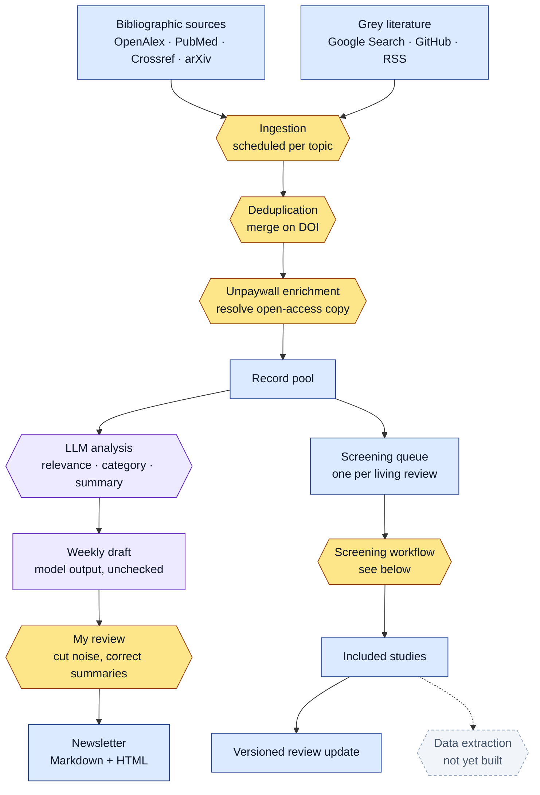
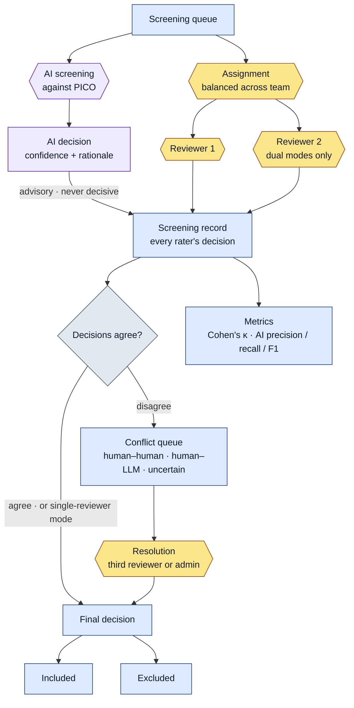

# Living Synthesis: what it is and what it does

*A note for colleagues working in evidence synthesis.*

## The problem I was trying to solve

Surveillance is the part of a living review that decays first. The protocol gets written, the searches get run, the review gets published — and then the field carries on moving while the update cycle slips from quarterly to annual to never. The work of staying current is not intellectually difficult, but it is relentless, and it is spread across sources that do not talk to each other: bibliographic databases, preprint servers, methods blogs, software releases, conference threads.

The problem is sharper in fast-moving methodological areas. My own case was the use of large language models in evidence synthesis, where a good deal of what matters appears first as a preprint or a repository and only later, if ever, as a journal article. A monthly database alert misses most of it.

I built two things in response. The first is a pipeline that runs a standing search and drafts a weekly digest. The second is a web application that turns the same machinery into shared infrastructure for a review team, with screening, assignment and conflict resolution built in.

## How the pieces fit together

Both products draw on one ingestion layer. Shape carries *what* a node is — rectangles are sets of records, hexagons are processes. Colour carries *who produced it*: purple for the model's own unchecked output, amber for a step a person performs, blue for a record a person has checked or that arrived from a source. Dashed means not yet built.

The screening workflow, expanded:

## What the search covers

The pipeline queries PubMed, OpenAlex, Crossref and arXiv for the bibliographic record, and supplements these with Google Custom Search for blogs and news, GitHub for tool releases, and a set of RSS feeds. Records are merged on DOI where one exists, and open-access copies are resolved through Unpaywall so that a link to the full text is available at the point of screening rather than two clicks later.

The intention behind the grey-literature sources is recall, not novelty for its own sake. In this particular area a tool is often released, discussed and adopted well before it is written up, and a search restricted to indexed journals gives a systematically late picture of the field.

## What the model does, and what it does not do

Each retrieved record is passed to a large language model — currently GPT-4o through OpenRouter, though the model is configurable per user — which reads title and abstract and returns four things: a relevance score, a short rationale for that score, a category, and a plain-language summary of what the item contributes.

For a living review, the model additionally screens each record against the review's PICO criteria and returns an include/exclude/maybe decision, a confidence value, and a written rationale. This is the part that warrants care, so I want to be explicit about the design.

The model's decision is stored as one input among several, not as an outcome. It sits in the same record as the human reviewers' decisions and is treated as a fallible additional rater. A review can be run in single-reviewer mode, in dual mode where two reviewers screen independently and disagreements are flagged, or in dual-consensus mode where a third reviewer adjudicates. Disagreement between a human and the model is recorded as its own category of conflict, alongside human-human disagreement and clusters of uncertain decisions, and it surfaces in the same resolution queue. The model has no route by which it can exclude a record on its own authority.

The application also records what it needs in order to be checked: accuracy, precision, recall and F1 for the model's decisions against the human record, and Cohen's kappa for inter-rater reliability between screeners. That instrumentation exists because I think a tool of this kind should be auditable by the people relying on it. I should be equally clear that I have not yet run a validation study on a completed review, so I cannot at present tell you what those numbers look like at scale, and nobody should treat the screening as validated until someone has.

## Where the human stays

The pipeline stops and produces a draft rather than publishing. I read it, cut what is noise, and correct summaries that have drifted from what the paper actually says. That step has never been redundant.

In the review application the same principle holds structurally rather than by convention: assignments are distributed across a named team with roles and workload balancing, screening decisions are attributed to individuals, conflicts must be resolved by a person, and each review update is versioned so that the set of studies added in a given round can be inspected after the fact. Reviews can carry their PROSPERO, Cochrane, Campbell or OSF identifiers and a link to the registered protocol, so that what the system does can be checked against what was pre-specified.

## Limitations worth stating plainly

The model summarises from title and abstract, and abstracts misdescribe papers often enough that a summary is a pointer to a paper rather than a substitute for reading it. Relevance scoring is calibrated by nothing more principled than my own judgement about what belongs in the digest, and it will reflect my priorities rather than yours. Recall from the grey-literature sources is genuinely unknown; Google Custom Search is a black box, and I cannot characterise what it is not returning. Deduplication on DOI works well for journal articles and not at all for the substantial share of records that have no DOI, so some duplication survives into the draft.

None of this has been evaluated against a reference standard. What I can say is that it has changed how I keep up with a literature, from something I did badly and intermittently to something that takes twenty minutes a week. Whether it holds up for a team screening at volume, under conditions where a missed study matters, is exactly the question I have not yet answered.

## Where it stands

The pipeline runs, and has been producing weekly digests for some months. The web application supports accounts, user-defined topics with scheduled ingestion, screening queues, team assignment, conflict resolution with reliability statistics, versioned review updates, and both systematic reviews and evidence gap maps. It runs locally and in Docker; it is not yet deployed for outside users.

What would be most useful to me now is a real review to test it against — ideally one where the screening decisions already exist, so that the model's suggestions can be compared against a human record that was made without reference to them. If you have a completed or in-progress review and would be willing to let me run that comparison, I would like to hear from you.
