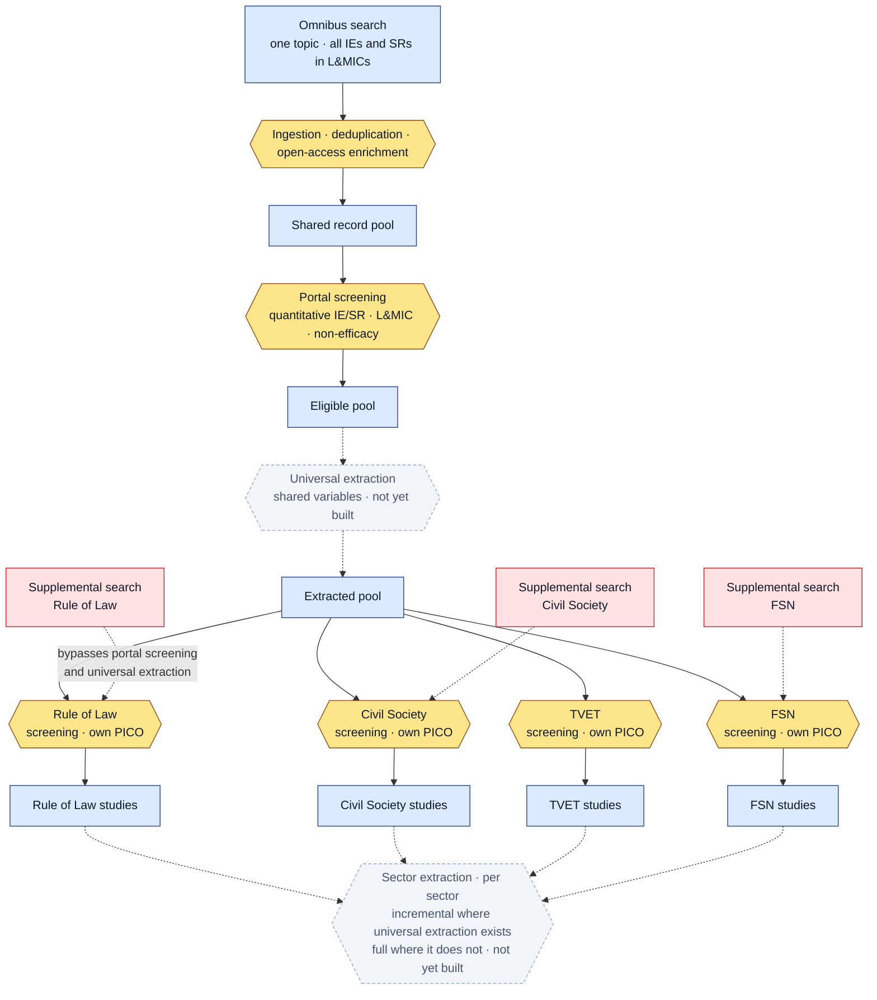

# Omnibus search architecture

**Status: design note. Not implemented.** This describes a pattern the application does not currently support, the changes that would be needed, and the questions that should be settled before any of it is built.

## The pattern

3ie's Development Evidence Portal uses a "search once, screen many" architecture. A single omnibus search covers all impact evaluations and systematic reviews in low- and middle-income countries. That pool passes through one portal-level screening step, which applies criteria common to everything downstream (quantitative IEs and SRs, L&MIC interventions, non-efficacy conditions), and then through one universal data extraction pass. Only then does the pool fan out to sector-specific screening — Rule of Law, Civil Society, TVET, Food Security and Nutrition — each with its own criteria, its own study set and its own incremental extraction.

The efficiency comes from amortisation: the search is run once rather than four times, and the variables common to every sector are extracted once rather than four times.

Three of the four sectors additionally run a supplemental search that feeds directly into sector screening, downstream of both the portal screening and the universal extraction.



Red nodes are records that enter downstream of the shared quality gates. Dashed nodes and edges do not exist in the application.

## What the application supports today

The left-hand spine maps onto existing concepts without modification. An omnibus search is a `Topic` with scheduled ingestion via Celery beat. Deduplication on DOI and Unpaywall enrichment already run on every ingested record. Portal screening and sector screening are both `LivingReview` records with their own PICO criteria, screening mode, team and conflict queue.

The fan-out itself is already possible: several `LivingReview` records can sync from the same `Topic`, which is exactly the one-search-to-many-reviews relationship the pattern needs. Versioned updates through `ReviewUpdate` and `added_in_version` handle the living behaviour, so a re-run of the omnibus search can be screened as an increment rather than from scratch.

## What is missing

Three changes, in dependency order.

### 1. Many-to-many between topics and reviews

`LivingReview.topic_id` is a single nullable foreign key, so a review can draw from exactly one topic. A sector review that takes both an omnibus feed and its own supplemental search cannot be expressed.

```
review_sources
    living_review_id   FK living_reviews   NOT NULL
    topic_id           FK topics           NOT NULL
    source_role        enum(primary, supplemental)
    added_at           timestamp
    PRIMARY KEY (living_review_id, topic_id)
```

`LivingReview.topic_id` would be retained for one release and backfilled into `review_sources` with `source_role = primary`, then dropped.

### 2. Provenance on the screening record

Once a review has several sources, every screening record needs to know which one a paper arrived through. This is what distinguishes a record that has passed portal screening and universal extraction from one that has not, and it is the input to the branch in point 3.

```
paper_screenings
    + source_topic_id   FK topics    NULL
    + source_role       enum         NULL
```

Nullable because existing rows have no meaningful provenance and should not be given a false one.

### 3. An extraction layer with two tiers

Nothing in the current models covers extraction. The design needs a universal tier keyed on the paper alone, and a sector tier keyed on the paper and the review, with the sector tier able to read the universal record where one exists.

```
extraction_templates
    id                 uuid PK
    living_review_id   FK living_reviews   NULL   -- null = universal template
    name               text
    schema             jsonb                      -- field definitions

extractions
    id                 uuid PK
    paper_id           FK papers           NOT NULL
    living_review_id   FK living_reviews   NULL   -- null = universal extraction
    template_id        FK extraction_templates
    data               jsonb
    extracted_by       FK users            NULL
    ai_generated       boolean DEFAULT false
    verified_by        FK users            NULL
    created_at, updated_at
    UNIQUE (paper_id, living_review_id, template_id)
```

A nullable `living_review_id` carries the universal-versus-sector distinction in one table rather than two. Sector extraction for a given paper resolves by reading the universal row first and then overlaying the sector row, so a paper that arrived through a supplemental search simply has no universal row to inherit and requires full extraction. That behaviour falls out of the schema rather than needing to be special-cased.

Keeping `ai_generated` and `verified_by` separate preserves the same discipline used in screening: a model may populate a field, but the record shows that a person has or has not checked it.

## Questions to settle first

These concern the architecture rather than the implementation, and the answers change what gets built.

**Is sector screening gated on universal extraction completing?** As drawn, the fan-out happens from the extracted pool, so an extraction backlog blocks all four sectors. If screening can in fact run in parallel from the eligible pool, with extraction catching up behind it, the schema is the same but the workflow and the user interface are not.

**How are supplemental records meant to be treated?** They reach sector screening without portal screening, so a sector's study set may contain studies that would have failed the common criteria. Either that is intended, in which case sector outputs are not strictly subsets of the portal and should not be described as such, or supplemental records should be routed through portal screening first, which changes the diagram.

**Why does TVET have no supplemental search?** If the other three sectors needed supplementing, the default expectation should be that TVET does too. Whether this is a judgement about omnibus coverage or a difference in resourcing determines whether the application should treat a missing supplemental source as normal or flag it.

**Can a sector be broader than the portal on any dimension?** The restrictions to quantitative studies, to L&MICs and to non-efficacy conditions are applied once, upstream of the fan-out, and cannot be relaxed downstream. A sector needing qualitative evidence or efficacy-condition studies can only obtain them through a supplemental search. Sector teams should know that their eligibility criteria are constrained by a decision taken above them.

**What happens to extraction when a template changes?** If a variable is added to the universal template after extraction has run, existing rows are incomplete. The options are re-extraction, versioned templates, or accepting sparse data, and the choice affects whether `extraction_templates` needs a version column.

## Not decided

Whether to build any of this. The pattern is a good fit for the application's existing structure, and points 1 and 2 are small. Point 3 is a substantial piece of work and should not start until the questions above have answers, since several of them change the shape of it.
